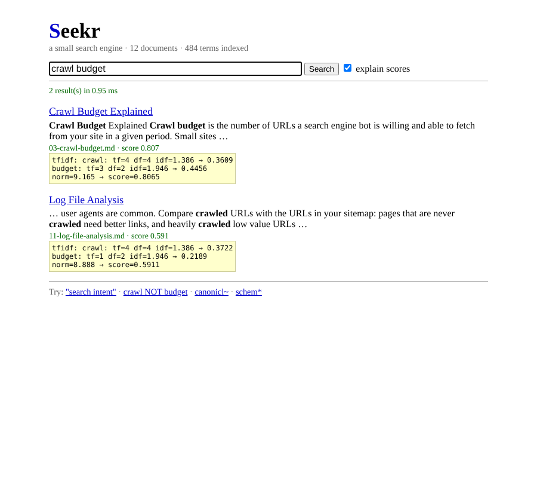

# Seekr

A small search engine written to understand how search actually works: a **positional inverted index**, **TF-IDF / BM25** ranking, a **boolean + phrase + fuzzy** query language, highlighted snippets, a persisted index and a plain **1998-style web UI**. Python standard library only, zero dependencies.

**Live demo (search in your browser):** https://nazarsak.github.io/seekr/

Based on Lab 15 of [Programming-Practice-Projects](https://github.com/rmalkevy/Programming-Practice-Projects) ("Build a 1998-Era Google").

```
$ seekr search "search intent" -n 3
3 result(s) in 0.65 ms   (terms: search, intent)

 1. Understanding Search Intent   [02-search-intent.md]   score 0.748
    Understanding **Search** **Intent** **Search** **intent** describes the goal behind a query. ...
 2. Keyword Research Basics   [01-keyword-research.md]   score 0.545
    … related **searches** and competitor pages. For every keyword record the monthly **search** volume ...
 3. Writing Content Briefs   [10-content-briefs.md]   score 0.290
    … the target keyword, the **search** **intent**, the audience, the outline with headings ...
```




*Terminal demo: the commands are really executed and their output is rendered by `scripts/make_demo_gif.py` (only the typing is animated).*

## Level achieved

| Level | Status |
|---|---|
| **Basic** "It searches" — ≥10 files, in-memory inverted index, single-word search, sorted by count | done |
| **Standard** "It ranks" — AND, TF-IDF, stop words, highlighted snippets, index saved to disk and reloaded | done |
| **Advanced** "It's a real tool" | partial: see side quests |

**Side quests completed:** TF-IDF + BM25 · phrase search (positional index) · boolean `AND` / `OR` / `NOT` with parentheses · stemming (light stemmer, not Porter) · fuzzy search (Levenshtein ≤ 2) · prefix search and autocomplete · web UI with live results.
**Not done:** PageRank-lite, live re-indexing, Wikipedia-scale run, a public deployment.

## My twist: "Teaching mode" on an SEO knowledge base

*Dataset:* 12 short articles on technical SEO (crawl budget, canonicals, hreflang, Core Web Vitals…), my professional field, so I can judge result quality myself.
*Twist:* `--explain` (and "explain scores" in the web UI) shows **why** each result scored what it did: for every query term its tf, df, idf and contribution. A search engine you can interrogate is one you can debug and defend.

```
$ seekr search "crawl budget" -n 2 --explain
 1. Crawl Budget Explained   score 0.807
    why (tfidf):
      crawl     tf=4  df=4  idf=1.386  -> 0.3609
      budget    tf=3  df=2  idf=1.946  -> 0.4456
      length-norm=9.165  total=0.8065
```

## Setup

```bash
git clone <this repo> && cd seekr
python -m venv .venv && source .venv/bin/activate   # Windows: .venv\Scripts\activate
pip install -e .                                    # or run without installing: PYTHONPATH=src python -m seekr ...
seekr index corpus            # build + save index to .seekr/index.json.gz
seekr search "crawl budget"
seekr serve                   # http://127.0.0.1:8000
python -m unittest discover -s tests   # 25 tests
```

A bigger corpus: `python scripts/fetch_gutenberg.py books && seekr index books` downloads ten public-domain novels (needs internet; I could not run this script in my sandbox, so treat it as untested).

### Query language

| Query | Meaning |
|---|---|
| `crawl budget` | both words (implicit AND) |
| `canonical OR hreflang` | either |
| `crawl NOT budget` / `crawl -budget` | exclusion |
| `"search intent"` | exact phrase (uses stored positions) |
| `(canonical OR hreflang) sitemap` | grouping |
| `canonicl~` | fuzzy, edit distance 1–2 |
| `schem*` | prefix |

Options: `--ranker tfidf|bm25`, `--explain`, `-n N`.

## How it works (plain language)

A book has an index at the back: word → pages. Searching the book means reading the index, not every page. An **inverted index** is that, for documents: `term → {document → [positions]}`. Finding the documents for a word is one dictionary lookup, so the cost does not grow with the number of documents you *don't* match. Grep has to open and scan every file, every time.

Pipeline: read file → lowercase → split into words (Unicode-aware) → drop stop words → light-stem → store `(term, position)`. The **same** pipeline processes the query, otherwise `Hello` would never find `hello`. Positions count dropped stop words too, so "search of engines" is not mistaken for the phrase "search engines".

**Ranking (TF-IDF):** `score = Σ (1 + ln tf) · ln(1 + N/df) / √length`. A word repeated 10× counts less than 10× (sub-linear), rare words count more than common ones (idf), long documents are damped. I add the `1 +` inside the log because the textbook `ln(N/df)` is exactly 0 for a word present in every document.

**Persistence:** gzip-JSON with delta-encoded positions, written to a temp file and renamed (a crash never leaves a half-written index).

## Measurements

Machine: cloud sandbox, Python 3.13, single thread. Reproduce with `seekr bench corpus` and `seekr bench --synthetic 20000`.

**Real corpus (12 docs, 8 KB):** build 2 ms, index file 4.7 KB, reload 1 ms, query latency p95 **0.2–0.7 ms** (fuzzy `rankng~` 3.5 ms, because it scans the vocabulary). At this size the index gives no speed-up over grep (~0.3 ms): the corpus is tiny. The advantage only shows at scale, see below.

**Synthetic stress test (20,000 documents, 48.5 MB, Zipf-distributed words, so not real language):**

| Metric | Result |
|---|---|
| Index build | 14.4 s (3.4 MB/s) |
| Index file / reload | 19.4 MB / 16.8 s |
| Rare term (1,124 hits), p50 / p95 | 3.9 / 5.2 ms (**127× faster** than scanning all files) |
| `OR` of two rare terms, p50 | 3.2 ms (131×) |
| Term present in every doc (20,000 hits), p50 / p95 | 46 / 66 ms (10×) |
| Phrase with 7,229 candidate docs, p50 / p95 | 108 / 144 ms (4×) |

Honest reading: selective queries are far below the 100 ms target. Queries that match nearly the whole collection are slower because every match has to be scored, and a phrase over very common words is the worst case (144 ms p95, over the 100 ms goal). In real text such words are stop words and are filtered out. The reload time (17 s) is the weakest number: JSON parsing plus rebuilding the dicts is slow at this size; a binary format with lazy loading would fix it (see "what I'd change").

## Limits and decisions

- `light_stem` is a small suffix stripper, not Porter. It merges ranking/ranked/ranks → `rank`, but can over-stem (`news` → `new`) or under-stem irregular forms.
- Stop-word-only queries ("the of and") return an explanatory message, not an error or the whole corpus.
- Empty / whitespace-only files are skipped and reported at index time; non-UTF-8 files fall back to cp1252; duplicate filenames are distinct because identity is the relative path.
- Snippets are cut from the original file at query time (only for the top results), snapped to word boundaries.
- Fuzzy search scans the whole vocabulary: fine for 40k terms, would need a BK-tree or trigram index for millions.
- No concurrency control: rebuild the index while the server runs → restart the server.

## What I would change first for a billion documents

Stop holding everything in one process's RAM. Shard the index by document ID range, store postings as compressed sorted lists (delta + variable-byte) on disk and memory-map them, merge segments in the background (the Lucene model), and fan queries out to shards with a top-k merge. Add skip pointers so AND intersections of long lists don't touch every entry.

## Demo script (5 minutes)

1. `seekr index corpus` — show terms count, build time, file size.
2. `seekr search "crawl budget" --explain` — explain tf/df/idf for the top result live.
3. `seekr search "search intent"` then `seekr search '"search intent"'` — AND vs phrase.
4. `seekr search "crawl NOT budget"`, `seekr search "canonicl~"`.
5. `seekr search "the of and"` — stop-word-only handling.
6. `seekr bench corpus`, then `seekr serve` and type in the box (live results, "explain scores").

## Project layout

```
src/seekr/  tokenizer.py  index.py  query.py  ranker.py  snippets.py
            persist.py  loader.py  engine.py  fuzzy.py  web.py  cli.py  bench.py
tests/      25 unit tests (stdlib unittest)
corpus/     12 SEO articles (written for this project)
scripts/    fetch_gutenberg.py  make_demo_gif.py
```

## Contributions

Solo project.
